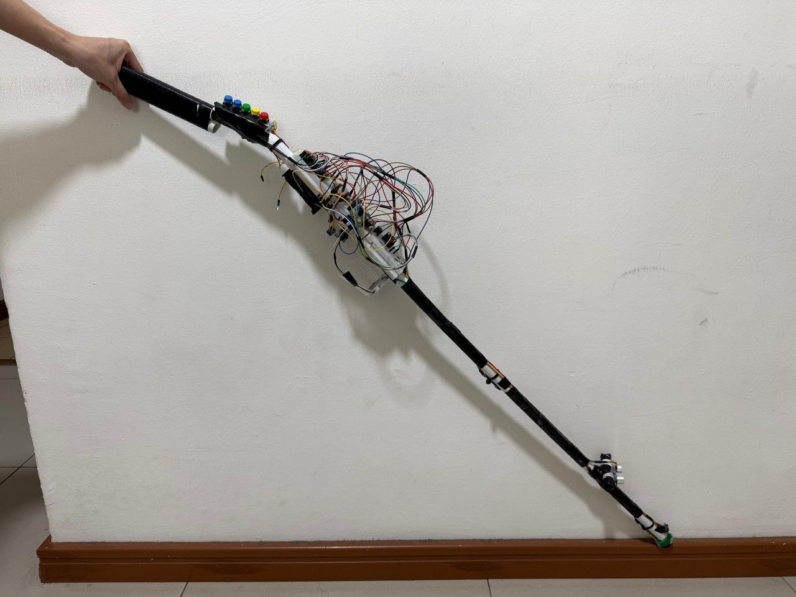
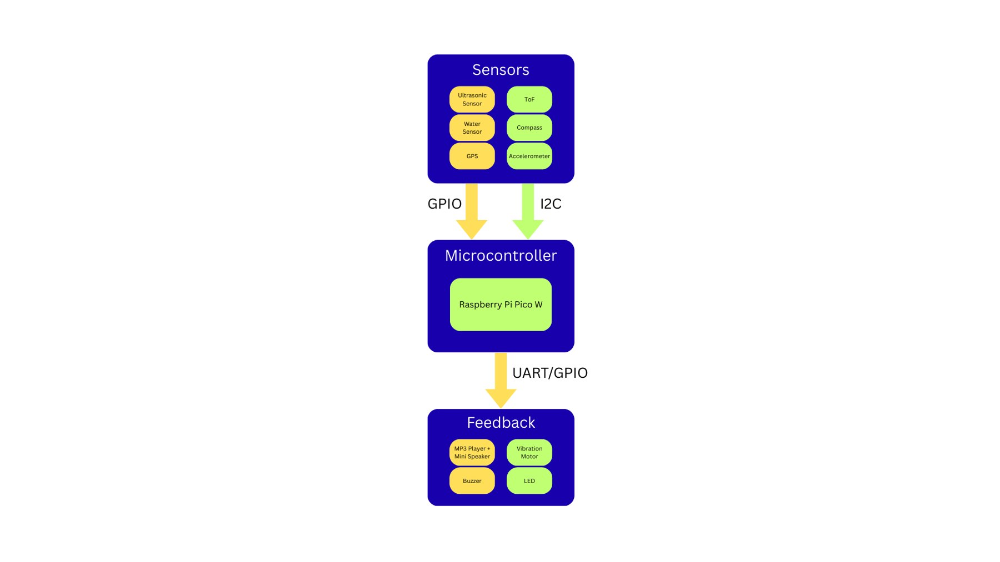
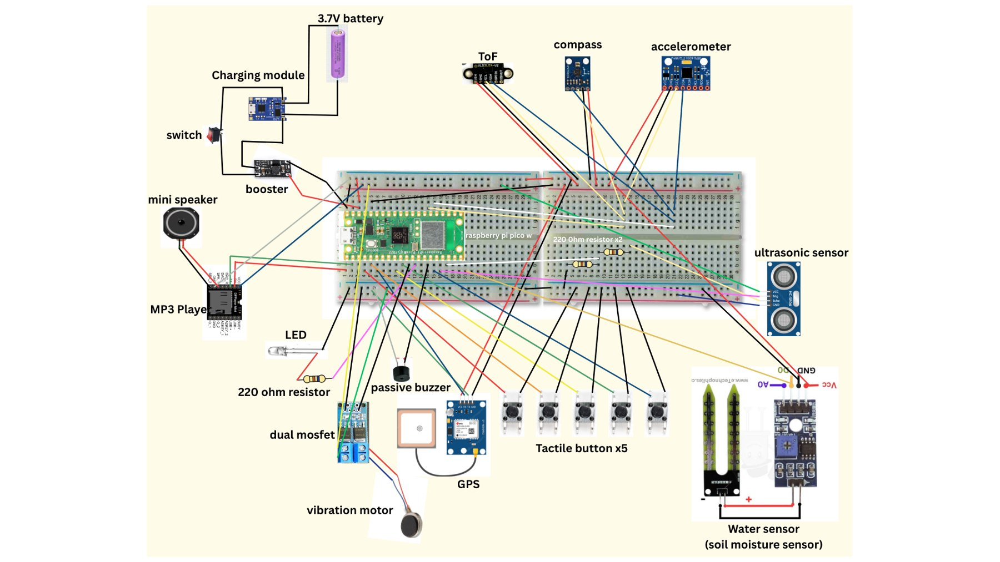
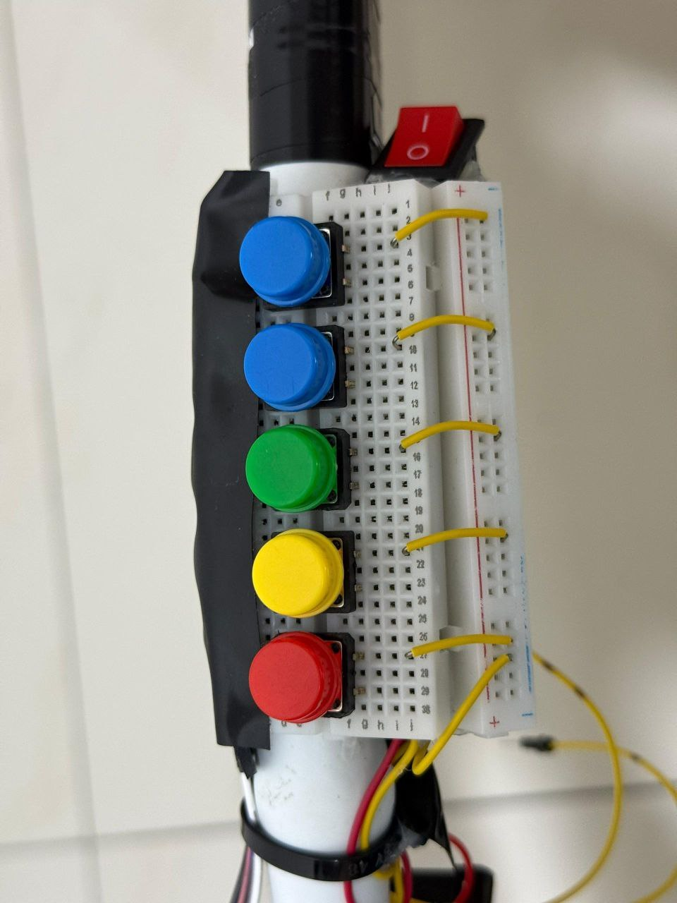
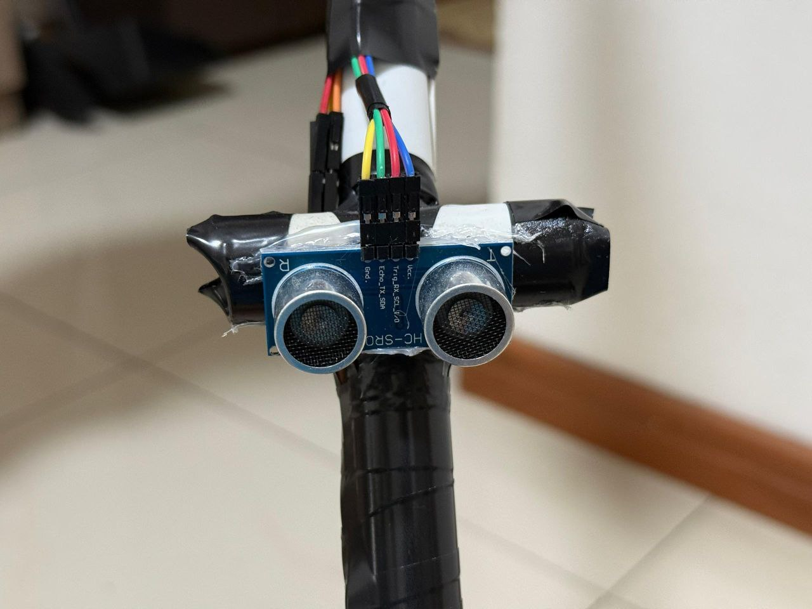
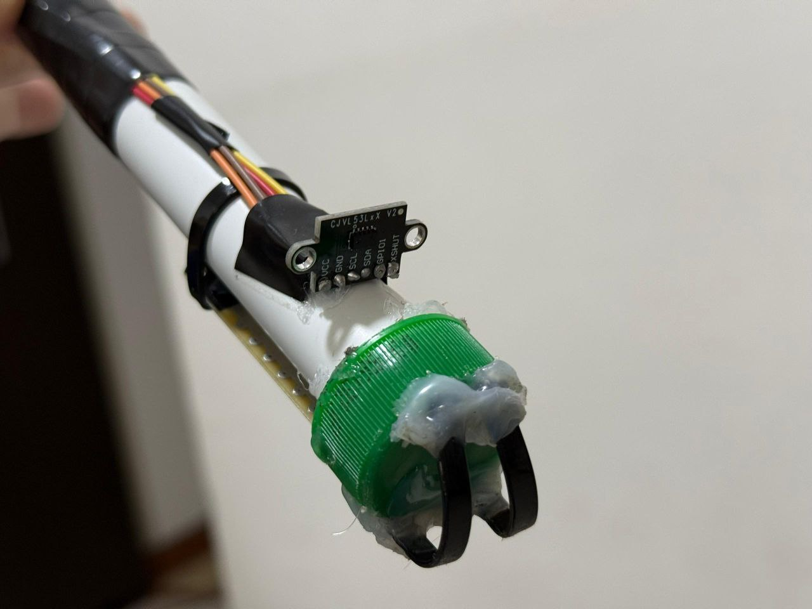
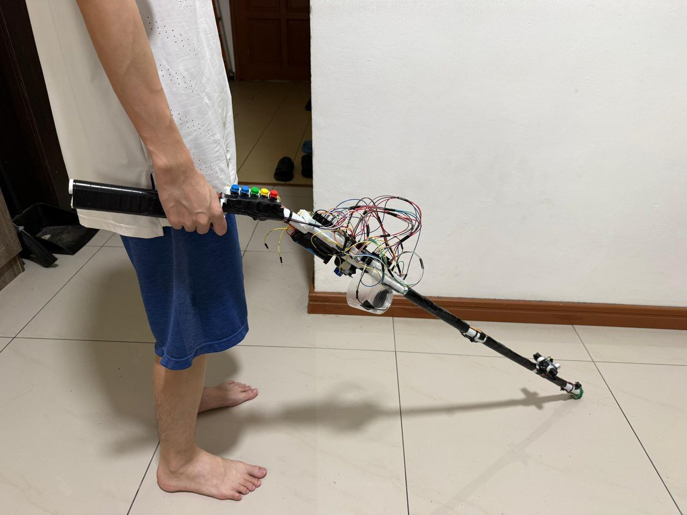
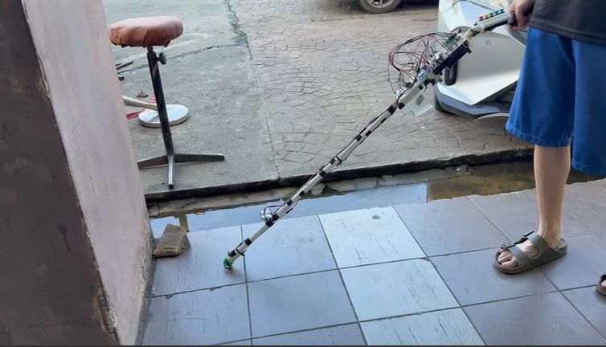

# Smart Cane — IoT Navigation & Hazard Detection

**University group project · Internet of Things · Universiti Malaysia Sabah (2025/2026)**

A prototype assistive smart cane built around a **Raspberry Pi Pico W**. The firmware combines several sensors to identify nearby obstacles and potential hazards, record GPS waypoints, and provide feedback using speech, buzzer patterns, and vibration.

> **Prototype notice:** This is a university prototype for demonstration and learning. It is **not a certified mobility or safety device**, and should not be relied on as a replacement for a conventional mobility aid or professional orientation-and-mobility training.

## Demo

[Watch the Smart Cane demonstration on YouTube](https://youtu.be/T_D4fgNtMgM)

## Highlights

- **Multi-sensor hazard detection:** HC-SR04 ultrasonic obstacle sensing, VL53L0X time-of-flight ranging for changes near the ground, water sensor, and MPU6050 motion sensing.
- **Prioritized warnings:** firmware selects a hazard based on priority so safety alerts take precedence over navigation prompts.
- **Sensor filtering and calibration:** baseline measurements, repeated-reading confirmation, and tilt-based checks to reduce misleading warnings.
- **Feedback:** DFPlayer Mini voice prompts, adjustable buzzer alerts, LED indication, and a vibration motor.
- **GPS navigation:** route-point recording, location/heading calculations and spoken directions; route data stored with LittleFS for later offline use (GPS reception is still required for positioning).
- **Physical controls:** five push buttons for the user interface and modes.

## Architecture

Sensor data passes through the Pico W firmware, which evaluates hazards, manages saved routes/navigation, and triggers audio, vibration and other feedback.

## Hardware and wiring

**Hardware wiring, GPIO/pin assignments and the setup diagram were contributed by [Sam (@SamanthaDAL)](https://github.com/SamanthaDAL).** Refer to [Hardware & setup](docs/HARDWARE.md) for the module list and pin map from the university prototype.

## Source code

The final submitted firmware is in [`SmartCane/SmartCane.ino`](SmartCane/SmartCane.ino). It is an Arduino sketch targeting the **Raspberry Pi Pico W (RP2040)**.

### Arduino setup (overview)

1. Install **Arduino IDE** and support for the Raspberry Pi Pico W using an RP2040 Arduino core compatible with this sketch.
2. Install the required libraries: `VL53L0X` (Pololu), `DFRobotDFPlayerMini`, and `TinyGPSPlus`. The Arduino core provides `Arduino.h`, `Wire.h`, and `LittleFS.h`.
3. Open `SmartCane/SmartCane.ino`, select **Raspberry Pi Pico W**, and review the pin assignments before connecting hardware.
4. Check sensor voltage levels, wiring, power supply, button behavior, sound output and calibration before attempting a demonstration.
5. The DFPlayer Mini expects compatible numbered audio tracks on its microSD card. **The original MP3 files are not included here**; spoken-alert behavior depends on supplying the matching files.

The repository contains the original final firmware rather than a modified or refactored version. **Compilation on a clean machine has not been re-verified for this GitHub package.** No compiled binaries are included.

## Prototype gallery

| User controls | Forward obstacle sensing |
| --- | --- |
|  |  |

| Cane tip sensing | Indoor demonstration |
| --- | --- |
|  |  |

The images show the actual university prototype, not a production device. Demonstration photos do not establish validated detection accuracy or safety performance.

## Contributions

**Ant — Lead Software Developer / Firmware Engineer**
- Independently wrote the project's complete firmware, including hazard-processing logic, sensor integration, GPS recording/navigation, voice/buzzer/vibration behavior, calibration and debugging.
- Assisted with soldering during the physical assembly.

**[Sam (@SamanthaDAL)](https://github.com/SamanthaDAL) — Hardware Contributor**
- Handled wiring and pin assignments, hardware integration and the system setup diagram.

**Design & Media Contributor — Product Design / Media**
- Worked on the physical cane's appearance, prepared the project video/media, and assisted with soldering.

**Two Materials Contributors — Procurement**
- Sourced and purchased project materials.

This is a team-built university prototype. Software authorship and hardware/design contributions are distinguished deliberately. See [Contributors](CONTRIBUTORS.md).

## Known limitations

- Sensor precision and GPS positioning vary with conditions and hardware placement.
- Routes are based on recorded GPS waypoints, not live map-based routing or guaranteed safe paths.
- GPS requires adequate satellite reception; offline saved routes do not remove that requirement.
- The prototype has not been independently safety-certified or validated for unsupervised use.
- The report and generated Arduino build files are intentionally excluded from this public code repository.

## Academic context

Developed for **KP44302 Internet of Things**, Universiti Malaysia Sabah, academic session **2025/2026**. Demo: https://youtu.be/T_D4fgNtMgM

## License

No open-source license has been selected for this repository. All rights are reserved unless the rights holders add a license. Please seek permission before reusing or redistributing the code or team-created media.
